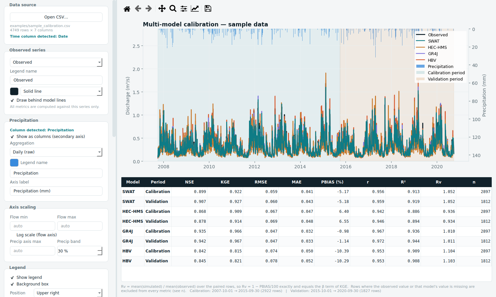

# Calibration Studio

A desktop tool (Python / PySide6) for evaluating and comparing hydrological model outputs against observed streamflow. Load one CSV with observed and simulated series, define calibration and validation periods, and get publication-ready hydrographs together with a full goodness-of-fit table.



## Features

- **Multi-model comparison** — any number of model outputs (e.g. SWAT, HEC-HMS, GR4J, HBV, LSTM) evaluated against one observed series
- **Goodness-of-fit metrics** computed separately for the calibration and validation periods: NSE, KGE, RMSE, MAE, PBIAS, Pearson r, R² and Rv (volume ratio). Rows with missing values are excluded pair-wise, and the sample size (n) is reported
- **Hydrograph** with shaded calibration / validation periods and precipitation drawn as hanging columns on an inverted secondary axis (daily, weekly or monthly totals)
- **Automatic column detection** for the time, observed and precipitation columns (English and Turkish keywords)
- **Full styling control** — per-series colour, line style, legend name, visibility and drawing order; axis limits, log scale and legend layout
- **Export** — metrics table as CSV, and one high-resolution PNG hydrograph per model with the same styling as the on-screen chart
- **Settings memory** — all styling is auto-saved between sessions and can also be saved to / loaded from named settings files, so figures stay consistent across reports

## Installation

Requires **Python 3.10+**.

```bash
git clone https://github.com/memduhardic/calibration-studio.git
cd calibration-studio

python -m venv .venv
# Windows:
.venv\Scripts\activate
# macOS / Linux:
source .venv/bin/activate

pip install -r requirements.txt
```

## Usage

```bash
python calibration_studio.py
```

1. **Open CSV** – the file with observed and simulated series
2. **Observed series** – check that the right column is selected as the reference
3. **Periods** – set the calibration and validation date ranges
4. **Style** – adjust colours, names, axes and legend as needed
5. **Export** – save the metrics table (CSV) and per-model hydrographs (PNG)

A synthetic sample file is provided in [`examples/`](examples/) for testing.

## Input format

One row per time step. A date column, one observed column, any number of model columns, and an optional precipitation column:

```csv
Date,Precipitation,Observed,SWAT,HEC-HMS,GR4J,HBV
2007-10-01,0.0,0.112,0.118,0.105,0.110,0.121
2007-10-02,4.3,0.139,0.142,0.131,0.137,0.150
```

Column names are flexible: the time, observed and precipitation columns are detected by keyword (`date`, `observed`, `precip`, `tarih`, `gözlem`, `yağış`, ...) and can be changed in the interface. If no date column is found, the row index is used.

## Metrics

| Metric | Description | Ideal |
|---|---|---|
| NSE | Nash–Sutcliffe efficiency | 1 |
| KGE | Kling–Gupta efficiency | 1 |
| RMSE | Root mean square error | 0 |
| MAE | Mean absolute error | 0 |
| PBIAS | Percent bias (positive = underestimation) | 0 |
| r / R² | Pearson correlation / coefficient of determination | 1 |
| Rv | Volume ratio, mean(sim) / mean(obs) | 1 |

Rv is identical to the β term of KGE and satisfies Rv = 1 − PBIAS/100.

## License

MIT — see [LICENSE](LICENSE).
